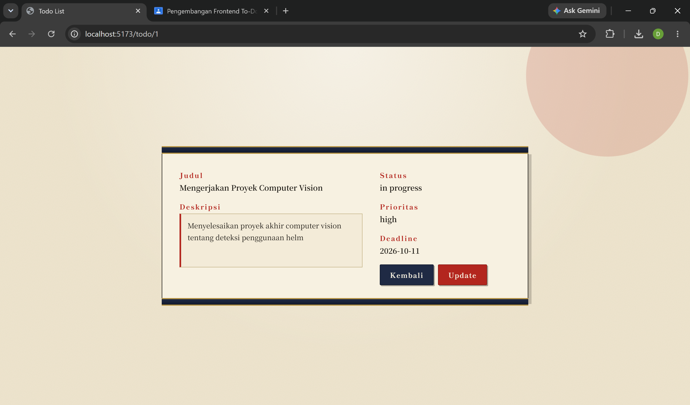
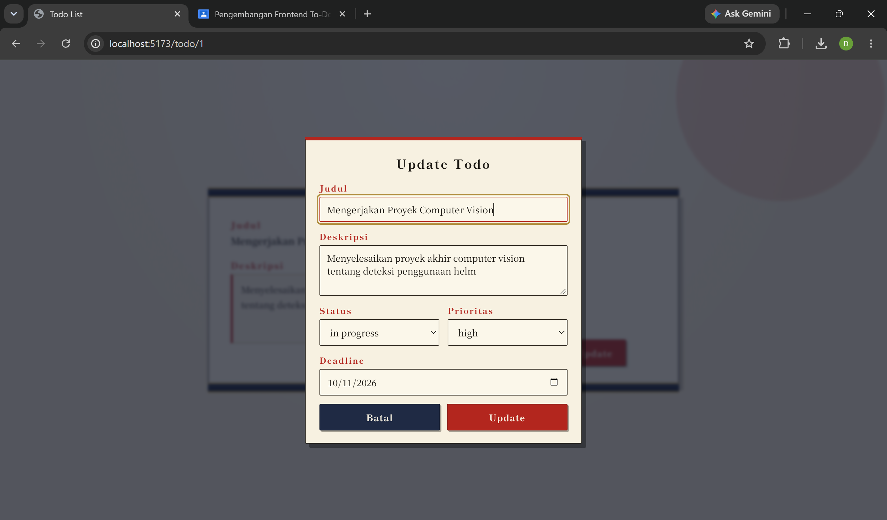
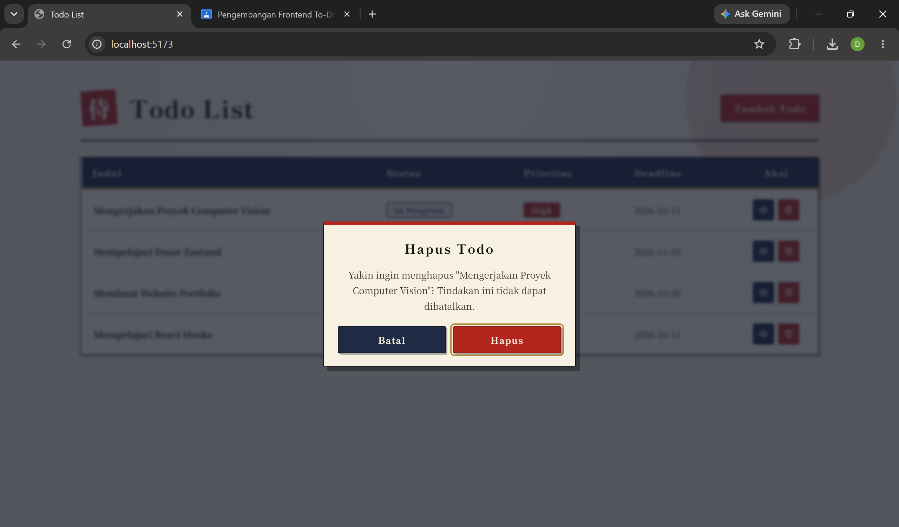

# Todo List – React.js

Aplikasi To-Do List frontend (Kuis Praktikum Pengembangan Frontend) menggunakan React.js + Vite.
Data masih berupa **data dummy** dan dikelola dengan **React State** (belum memakai REST API).

## Fitur
- Menampilkan daftar tugas
- Melihat detail tugas (`/todo/:id`)
- Menambah tugas lewat form modal
- Memperbarui tugas lewat form modal
- Menghapus tugas dengan dialog konfirmasi
- Umpan balik (toast) setiap operasi tambah, ubah, dan hapus

## Struktur Data
```js
{
  id: 1,
  title: 'Judul tugas',
  description: 'Deskripsi tugas',
  priority: 'low' | 'medium' | 'high',
  deadline: '2026-10-11',          // yyyy-mm-dd
  status: 'to-do' | 'in progress' | 'done'
}
```
Atribut mengikuti response REST API (`/api/todos`) sehingga mudah diintegrasikan pada pertemuan berikutnya.

## Menjalankan Aplikasi
```bash
npm install
npm run dev
```
Buka http://localhost:5173

## Struktur Folder
```
src/
├── components/   # TodoModal, ConfirmDialog, Toast, Icons
├── data/         # dummyTodos.js
├── pages/        # TodoList, TodoDetail
├── App.jsx       # state todos + operasi CRUD
└── index.css
```

## Screenshot
> Tambahkan screenshot hasil implementasi di sini sebelum dikumpulkan.

| Halaman | Screenshot |
|---|---|
| Daftar Todo |  |
| Tambah Todo |  |
| Detail Todo |  |
| Update Todo |  |
| Konfirmasi Hapus |  |
